

  

  
  
  
  
  

<b>A Fabric mod that gives the outer End its peoples.</b> 
Past the gateways, once the Dragon is dead, you find villages floating on their own islets, 
people who greet you as the one who silenced the Dragon, and the Citadels of the Court that set it loose.

---

## The peoples


Tall shell-folk of the purpur **Spires**. Formal, precise, dryly funny, keepers of records. Their lid lifts when they
talk and slams shut when they're hurt. They believe the shulkers in the old cities are their ancestors, so mind what
you do with shulker boxes.

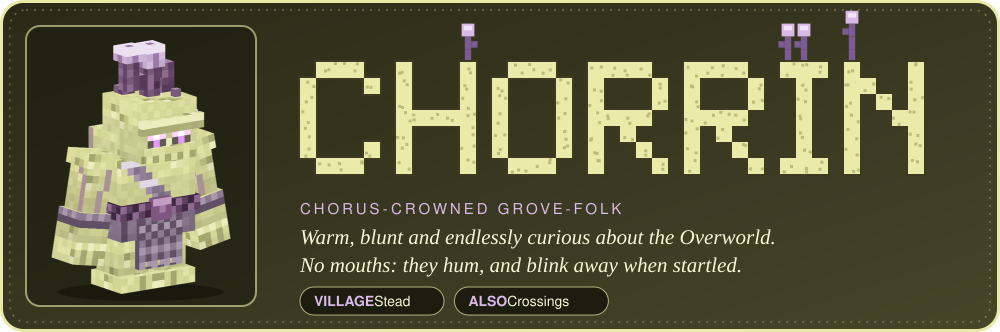

Stone-skinned, chorus-crowned grove-folk of the **Steads**. Warm, blunt and endlessly curious about the Overworld.
They have no mouths and hum instead, and blink away like chorus fruit when startled.

In the market towns called **Crossings**, Shulkin and Chorrin live side by side. Both have children. Nobody in the End
has a gender; everyone is "they".


The ruling caste of the Endermen, with a Lord, Voidmarshals, Riftguards and a Herald, Seer and Steward. Endermen in
bond-collars are their thralls. A **Citadel** attacks anyone who comes in without **Enderman Eyes**, the seal of a
Court envoy found on one End ship in five. Bring the Eyes and you're a guest: earn **Favor** with service and tribute,
and the Lord may give you a Voidhound pup.

## Their villages

<table>
  <tr>
    <td width="50%">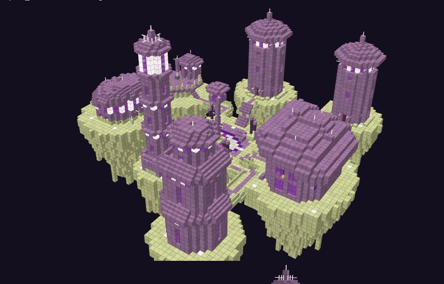 <b>Spire</b> (Shulkin): lidded purpur towers on islets joined by bridges.</td>
    <td width="50%">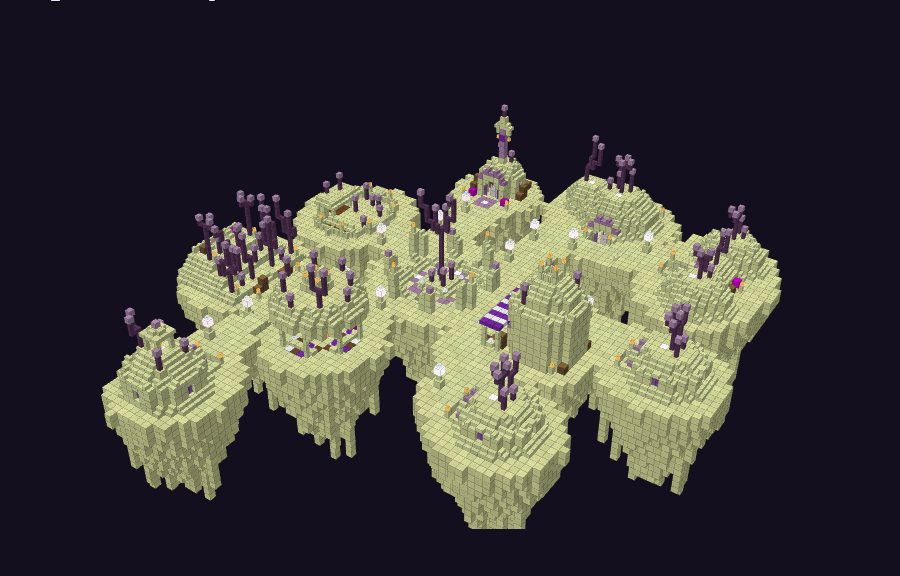 <b>Stead</b> (Chorrin): low groves and half-sunk domes.</td>
  </tr>
  <tr>
    <td width="50%">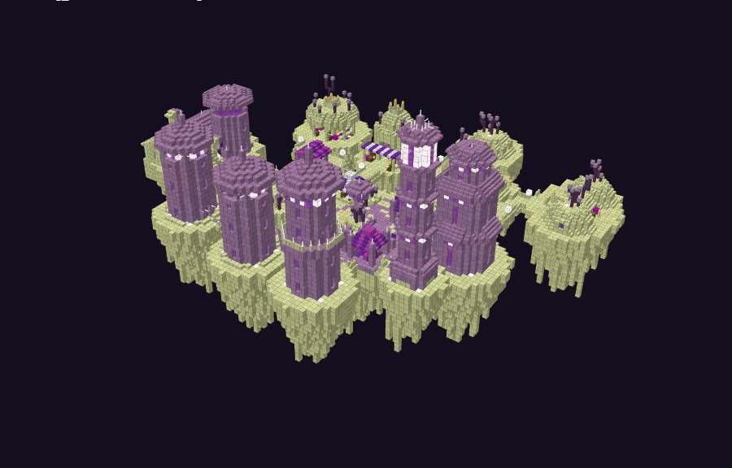 <b>Crossing</b>: both peoples together round a shared Crossing Hall.</td>
    <td width="50%">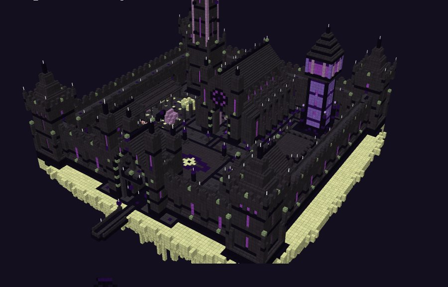 <b>Citadel</b>: the Court's walled seat. Rare, and hostile without the Eyes.</td>
  </tr>
</table>

Layout renders from the village tools. Villages sit at least 1,000 blocks from the main island.

## Talking

Right-click any Shulkin, Chorrin or (as a guest) Endarch. The conversation screen (Village Friends' layout, in
purpur) has their portrait, the line typing out in their voice, numbered replies and a gift button. Friendship shows
as ten chorus blossoms and the Court's Favor as ten eyes. About 9,300 lines of dialogue change as you grow closer.

<table>
  <tr>
    <td width="50%">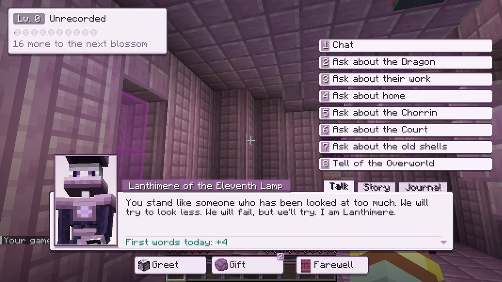 A Shulkin of the Eleventh Lamp, meeting you.</td>
    <td width="50%">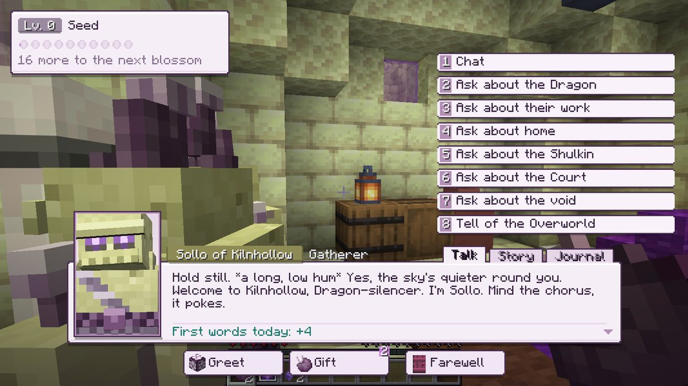 Sollo, a Chorrin gatherer, says hello.</td>
  </tr>
  <tr>
    <td width="50%">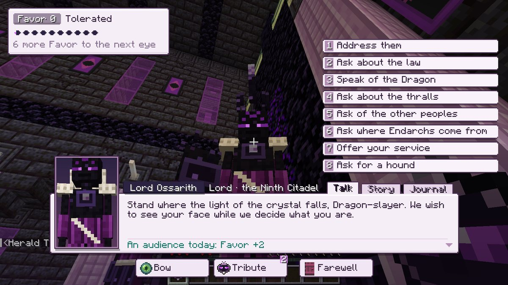 An audience with Lord Ossarith of the Ninth Citadel.</td>
    <td width="50%">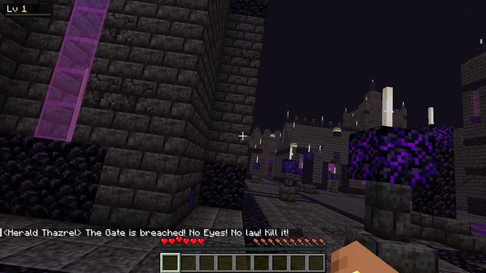 No Eyes? The gate is breached, and the Herald says so.</td>
  </tr>
</table>

- **Story:** everyone has a story of their own (55 in all). Help with what they ask, come back on other days, and
  they tell you the rest; answer them one of two ways and they give you something.
- **Journal:** your memories with each person, what you've learned about them, and their story so far.
- **Personalities:** most stand still while you talk; the shy keep their distance, the restless pace, the busy go
  back to work, a proud Lord ends the audience. Strike someone and they'll turn away from you until you say sorry.

<table>
  <tr>
    <td width="33%">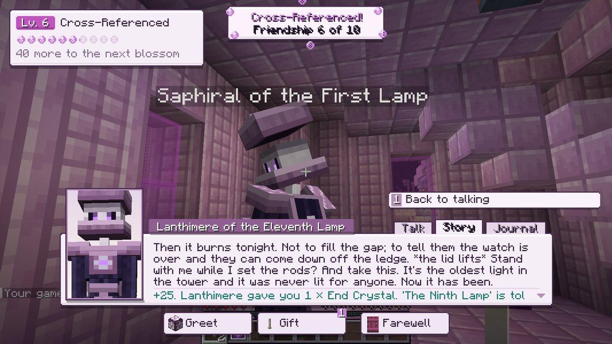 A Spire story.</td>
    <td width="33%">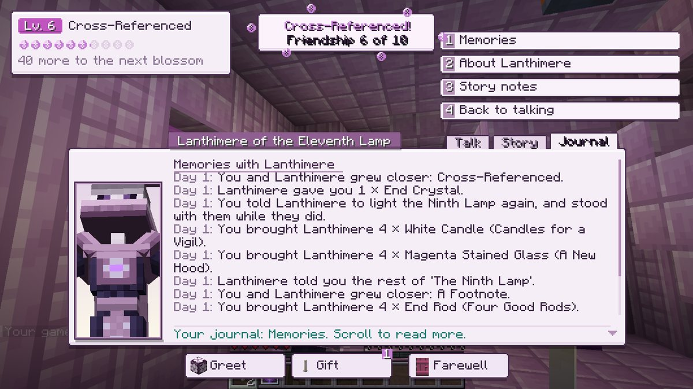 The Journal.</td>
    <td width="33%">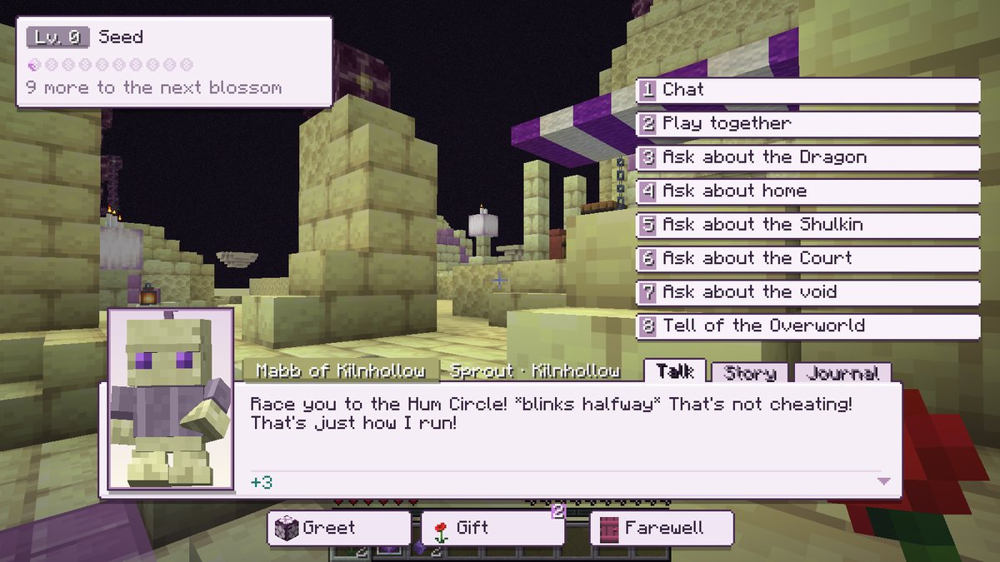 A sprout wants to play.</td>
  </tr>
</table>

## How they move

Each people has an animation pack of 70 to 75 clips (Shulkin, Chorrin and the Endarchs; the children have their
own). They idle in character and practise their trade, chat with a neighbour, greet you, gesture while they speak
and listen while you choose a reply, and react to gifts and tribute, a new level of friendship or Favor, a sorry
accepted and a blow. A Shulkin's lid peeks and lifts, a Chorrin hums and blink-hops, a Lord looms.

## Creatures

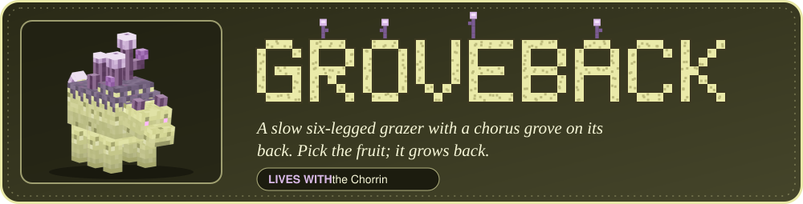

<table>
  <tr>
    <td width="50%">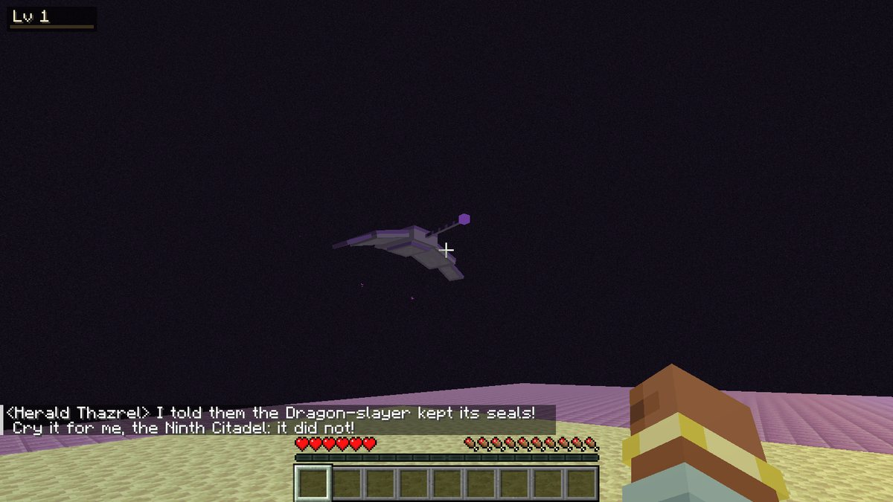 A tamed Driftray.</td>
    <td width="50%">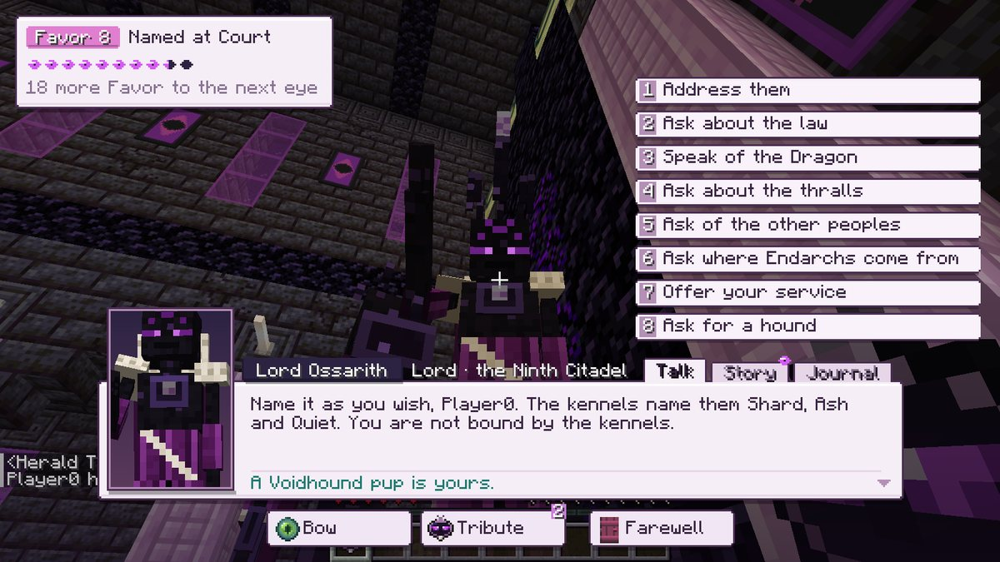 At eight eyes of Favor the Lord gives you a Voidhound pup.</td>
  </tr>
</table>

## Finding them

    /locate structure endexpansion:spire_village
    /locate structure endexpansion:stead_village
    /locate structure endexpansion:crossing
    /locate structure endexpansion:citadel

Citadels are rare.

---

## Building

Requires Java 25, Minecraft 26.3, Fabric Loader 0.19.5 and Fabric API. In the game's mod list it appears as
**End Expansion** (mod id `endexpansion`). It's part of the same modpack as
[Village Friends](https://github.com/radhepa/Village-Friends-Minecraft-Mod),
[Nether Friends](https://github.com/radhepa/NetherFriends) and [Sky Friends](https://github.com/radhepa/Sky-Friends).

    gradlew build                                              the mod jar, in build/libs
    gradlew runClientGameTest -PendTests=People                in-game test of the peoples, with screenshots
    gradlew runClientGameTest -PendTests=Villages              in-game test of the villages
    gradlew runClientGameTest -PendTests=Animations            every clip acted out in game, with screenshots

Design and developer notes are in `docs/`:

| Doc | What's in it |
|---|---|
| [PEOPLE.md](docs/PEOPLE.md) | The peoples and their lore. |
| [VILLAGES.md](docs/VILLAGES.md) | The buildings and how villages are generated. |
| [DIALOGUE.md](docs/DIALOGUE.md) | Conversations, friendship, Favor and the dialogue bank. |
| [ANIMATIONS.md](docs/ANIMATIONS.md) | The animation packs and how to author them. |

The `tools/` folder holds the Python that makes the models, textures, buildings, village layouts, animation packs
and dialogue checks.

## License

[MIT](LICENSE). The README art in `docs/readme/` is drawn from the mod's own models and in-game screenshots.
